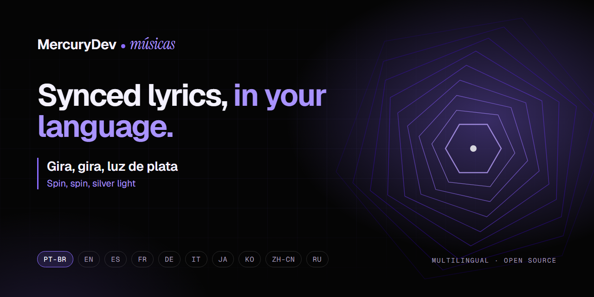
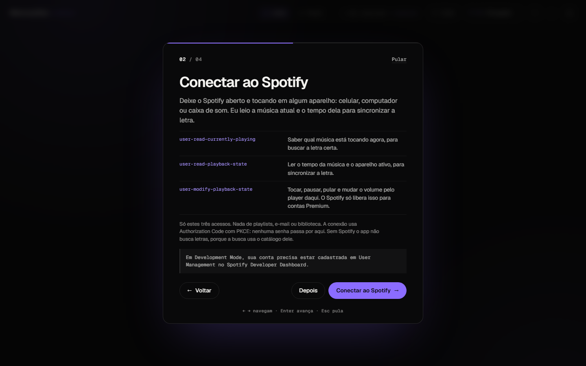
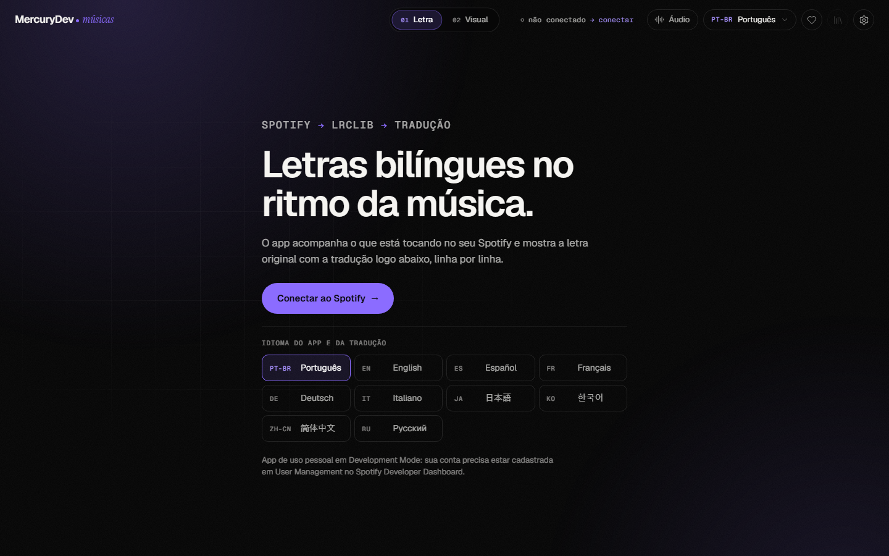
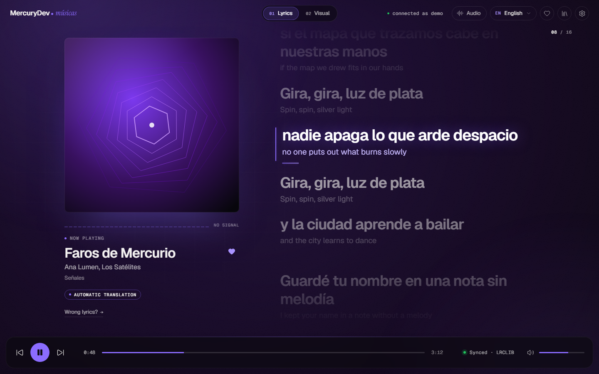
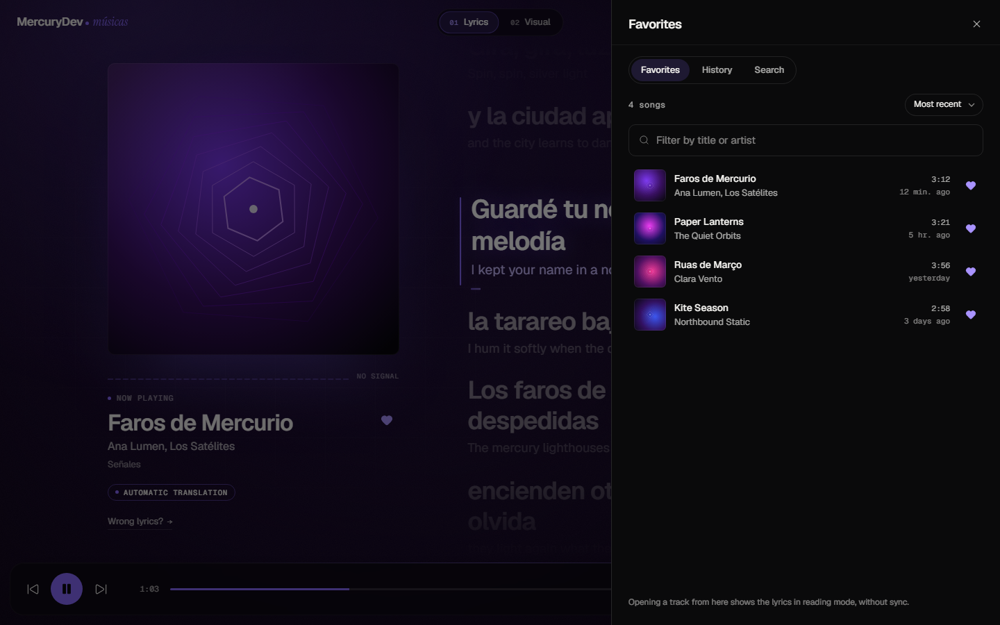
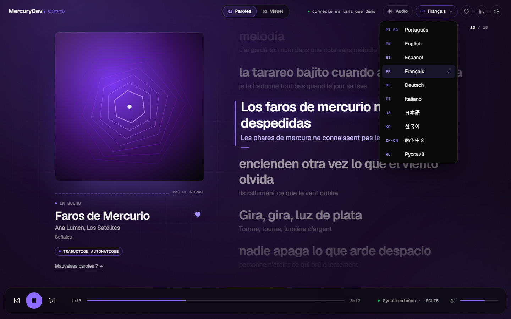
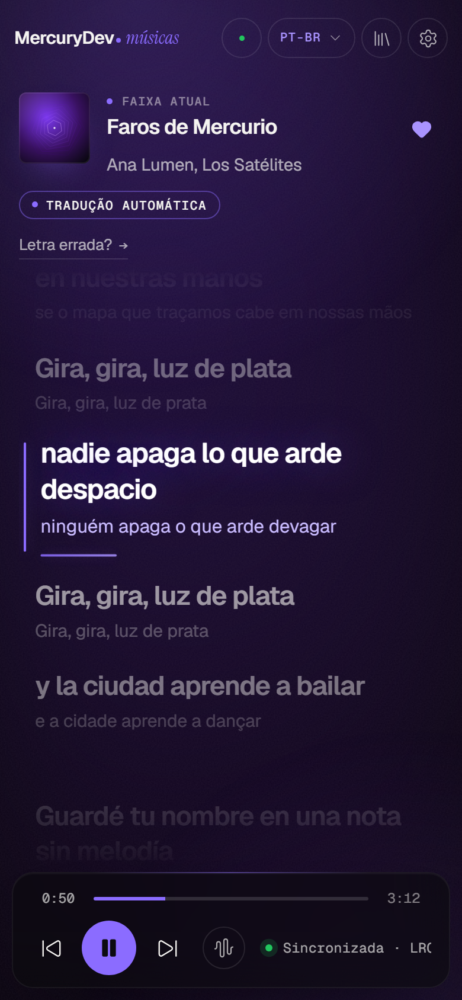

<p align="center">
  
</p>

<h1 align="center">MercuryDev Músicas</h1>

<p align="center">
  <strong>Synced lyrics for what you're playing on Spotify, translated line by line into your language.</strong>
</p>

<p align="center">
  <a href="LICENSE"></a>
  
  
  
  
  
  
</p>

<p align="center">
  English · <a href="README.pt-BR.md">Português (Brasil)</a>
</p>

---

MercuryDev Músicas is a self-hosted web app that follows the song playing on your Spotify account, fetches its lyrics from [LRCLIB](https://lrclib.net), and shows the original lyrics with a translation under each line, in time with the music. The whole interface and the lyric translation follow the language you pick, with 10 languages available out of the box.

It is built as a personal tool: you run it on your own machine with your own Spotify app (Development Mode) and your own translation key.

## Contents

- [Features](#features)
- [Multilingual by design](#multilingual-by-design)
- [Screenshots](#screenshots)
- [Getting started](#getting-started)
- [How it works](#how-it-works)
- [Adding a language](#adding-a-language)
- [Limitations](#limitations)
- [Roadmap](#roadmap)
- [Deployment](#deployment)
- [Rights and disclaimer](#rights-and-disclaimer)
- [Credits and contact](#credits-and-contact)

## Features

- **Synced lyrics**: the active line is highlighted and auto-scrolls with the music. A thin progress thread shows how far into the line you are, and a `07 / 42` counter shows your position.
- **Automatic translation into multiple languages**: each line gets its translation underneath. Repeated choruses are translated once, and lines already in your language are left as they are. Providers: DeepL (no LLM), Anthropic, or any OpenAI-compatible API.
- **Fully translated interface**: every screen, message and error uses i18n dictionaries, with pt-BR as the default and fallback. Changing the language takes effect immediately, re-translates the open lyrics and never reloads the page.
- **Spotify integration (OAuth PKCE)**: the server runs the Authorization Code with PKCE flow, so there is no client secret anywhere. Tokens are encrypted at rest and refreshed automatically, 401 and 429 responses are retried with backoff, and tokens never appear in logs.
- **Player controls**: play, pause, skip, seek and volume. Spotify only allows these through its API for Premium accounts, and the UI says so on Free accounts.
- **Favorites**: tap the heart on any track. You get a Favorites screen with a counter, a filter, sorting (most recent first) and removal. Favorites are stored per Spotify account on the server and stay visible after you disconnect.
- **First-run tutorial**: four steps (welcome, connect Spotify with each permission explained, language, favorites). It works with the keyboard, has Skip and Back on every step, and you can reopen it from Settings.
- **Connection status**: a log-style indicator (`● connected as …` / `○ not connected → connect`) with a disconnect button.
- **When lyrics have no timestamps**: you can use estimated auto-scroll, or "sync while playing", where you tap each line as it starts and the timings are saved.
- **"Wrong lyrics?"**: pick another LRCLIB candidate. You can also set a per-track sync offset.
- **Visual mode**: six audio-reactive Canvas 2D visualizers. They use system audio or your mic, only for analysis: nothing is played back, recorded or uploaded.
- **MercuryDev visual identity**: a dark base, mercury-purple accent, Geist and Geist Mono type, and geometric lines. The layout works on desktop, tablet and phone.
- **Accessibility**: visible keyboard focus, ARIA labels, an accessible language listbox and radiogroup, and support for `prefers-reduced-motion`.

## Multilingual by design

One choice sets both **the interface language and the lyric translation target**. The default is **pt-BR**.

| Code | Language | Interface dictionary |
|---|---|---|
| `pt-BR` | Português (Brasil) | source of truth, fallback |
| `en` | English | reviewed |
| `es` | Español | reviewed |
| `fr` | Français | reviewed |
| `de` | Deutsch | reviewed |
| `it` | Italiano | reviewed |
| `ja` | 日本語 | provisional, needs a native review |
| `ko` | 한국어 | provisional, needs a native review |
| `zh-CN` | 简体中文 | provisional, needs a native review |
| `ru` | Русский | provisional, needs a native review |

How it works:

- **Persistence**: the choice is stored in `localStorage` (`mercurydev-musicas:lang`) and loaded before the first render, so the wrong language never flashes.
- **Page metadata**: `<html lang>`, `dir` and the page title are updated.
- **Server settings**: the choice is sent to the server settings so translations use it.
- **Formatting**: dates, numbers and relative times ("5 min ago") use `Intl` in the chosen language.
- **RTL**: each language entry already carries `dir` (`ltr`/`rtl`), so a right-to-left language can be added later.
- **Tests**: `npm test` checks that every dictionary has exactly the pt-BR keys and placeholders, and that every key used in the code exists.

Adding another language takes four steps; see [Adding a language](#adding-a-language).

## Screenshots

> **Illustrative.** These screenshots use original demo data: a fictional song and artist ("Faros de Mercurio" by "Ana Lumen, Los Satélites", with lyrics written for this demo), generated covers, and a mocked Spotify session (user `demo`). No real lyrics, album art or personal data appear in them.

| First-run tutorial: connect Spotify | Language selection on the home screen |
|---|---|
|  |  |

| Synced lyrics, Portuguese UI and translation | Same song, English UI and translation |
|---|---|
|  |  |

| Favorites | Language picker over a French UI |
|---|---|
|  |  |

<p align="center">
  
</p>

## Getting started

### Prerequisites

- **Node.js 22.6+**, tested on Node 24. `better-sqlite3` downloads a prebuilt binary during install.
- **A Spotify account** to create the app in the [Spotify Developer Dashboard](https://developer.spotify.com/dashboard). In Development Mode, Spotify requires the **app owner** to have an active Premium subscription.
- **For translated lyrics: a DeepL API key** (the Free plan is enough: 500,000 characters per month). Without a translation provider the app still works, but it shows only the original lyrics. An Anthropic API key or any OpenAI-compatible endpoint also works instead of DeepL (see [step 3](#3-set-up-translation-deepl)).

### 1. Create the Spotify app

1. Open the [Spotify Developer Dashboard](https://developer.spotify.com/dashboard) and click **Create app**.
2. Under **Redirect URIs**, add exactly:
   ```
   http://127.0.0.1:8787/callback
   ```
   Use `127.0.0.1`, because Spotify does not accept `localhost`. The port is the API server's (`PORT`), not Vite's.
3. Under **Which API/SDKs are you planning to use?**, tick **Web API** and save.
4. In **Settings**, copy the **Client ID**. You do not need the Client Secret: login uses Authorization Code with PKCE.
5. In **User Management**, add the name and the **Spotify account email** of everyone who will use your instance (Development Mode allows up to 5 users).

**Requested scopes.** These are defined in `SPOTIFY_SCOPES` (`apps/server/src/config.ts`) and explained to users in tutorial step 02:

| Scope | Why |
|---|---|
| `user-read-currently-playing` | know which song is playing, to fetch its lyrics |
| `user-read-playback-state` | read playback position and the active device, to sync |
| `user-modify-playback-state` | play, pause, skip and volume from the app. Spotify only accepts these from **Premium** accounts |

### 2. Configure the environment

```bash
git clone https://github.com/higorkehrle/mercurydev-musicas.git
cd mercurydev-musicas
npm install
cp .env.example .env
node -e "console.log(require('crypto').randomBytes(32).toString('hex'))"   # paste into TOKEN_ENCRYPTION_KEY
```

Open the new `.env` and fill in `SPOTIFY_CLIENT_ID` (from step 1) and `TOKEN_ENCRYPTION_KEY` (the value printed by the `node -e` command). These two are required: without them the server starts but shows a configuration warning and login stays disabled. For translation, also set `TRANSLATION_PROVIDER` and `TRANSLATION_API_KEY` ([step 3](#3-set-up-translation-deepl)). Every variable is documented in [`.env.example`](.env.example).

| Variable | Required | Description |
|---|---|---|
| `SPOTIFY_CLIENT_ID` | yes | Client ID from the Spotify Dashboard. It is public by design; there is no client secret |
| `SPOTIFY_REDIRECT_URI` | no | default `http://127.0.0.1:8787/callback`; must match the Dashboard exactly |
| `TOKEN_ENCRYPTION_KEY` | yes | 32 bytes (hex or base64) used to encrypt tokens at rest (AES-256-GCM) |
| `PORT` / `HOST` | no | default `8787` / `127.0.0.1` |
| `WEB_ORIGIN` | no | frontend origin; default `http://127.0.0.1:5173` in dev |
| `DATABASE_PATH` | no | SQLite file; default `data/lyricsync.db` (git-ignored) |
| `COOKIE_SECURE` | no | `Secure` cookie flag; default `true` in production |
| `TRANSLATION_PROVIDER` | no | `deepl`, `anthropic`, `openai` (any compatible API) or `none` |
| `TRANSLATION_API_KEY` | for translation | the provider's key. DeepL Free keys end with `:fx` |
| `TRANSLATION_MODEL` | no | default `claude-opus-5-5` for `anthropic`; required for `openai` |
| `TRANSLATION_BASE_URL` | no | base URL of the OpenAI-compatible API |
| `MUSIXMATCH_API_KEY` | no | only with a **licensed** plan of the official API; enables a secondary provider |
| `LOG_LEVEL` | no | `debug`, `info`, `warn`, `error` |
| `APP_HOMEPAGE` | no | included in the User-Agent sent to LRCLIB |

> Never commit `.env`. It is git-ignored; only `.env.example` is tracked.

### 3. Set up translation (DeepL)

Translation is what puts each line's translation under the original. DeepL is the recommended provider: it is classic machine translation (no LLM), and the Free plan covers personal use.

1. Create a free account at [deepl.com/pro-api](https://www.deepl.com/pro-api) (choose **DeepL API Free**). A card is required for verification; the Free plan is not charged.
2. Open [deepl.com/your-account/keys](https://www.deepl.com/your-account/keys) and copy your **Authentication Key**. Free keys end with `:fx`.
3. In `.env`, set:
   ```bash
   TRANSLATION_PROVIDER=deepl
   TRANSLATION_API_KEY=your-key-here:fx
   ```
   Free keys (`:fx`) automatically use `api-free.deepl.com`; any other key uses `api.deepl.com`. You do not set the endpoint or `TRANSLATION_MODEL`.
4. Start (or restart) the server. Changes to `.env` are only read at startup.

The key stays on the server; the browser never sees it. To use another provider instead, set `TRANSLATION_PROVIDER=anthropic` (optional `TRANSLATION_MODEL`) or `TRANSLATION_PROVIDER=openai` (requires `TRANSLATION_MODEL`, optional `TRANSLATION_BASE_URL`). With `TRANSLATION_PROVIDER=none`, or no key, only the original lyrics are shown.

**What happens when a song plays** (details in [How it works](#how-it-works)):
1. The server fetches the lyrics and detects their language. Lines already in your chosen language are skipped.
2. Repeated lines, such as choruses, are translated once.
3. The unique lines go to DeepL in batches of up to 50, with the title and artist as context.
4. The answer is validated line by line; if it does not match, the server retries and then falls back to stanza-sized blocks.
5. The result is saved in the local SQLite database, so each song is translated only once per language.

### 4. Run

```bash
npm run dev        # API on 127.0.0.1:8787 + Vite on 127.0.0.1:5173
```

Open **http://127.0.0.1:5173**, not `localhost`, because the session cookie is per host. Follow the tutorial or click **Connect to Spotify**, then press play on any device. The lyrics show up within a few seconds, with the translation under each line.

The terminal prints `INFO: Server listening at http://127.0.0.1:8787`. If it also prints `WARN: incomplete configuration`, the line after it names the missing `.env` value.

**Troubleshooting**

| Symptom | Cause and fix |
|---|---|
| `WARN: incomplete configuration` with `SPOTIFY_CLIENT_ID is not set` | `.env` is missing, or still has the `your_spotify_client_id_here` placeholder. Paste the real Client ID and restart |
| `TOKEN_ENCRYPTION_KEY is missing or invalid` | It must be 32 bytes as 64 hex characters (or base64). Regenerate it with the `node -e` command in step 2 |
| Spotify says `INVALID_CLIENT: Invalid redirect URI` | The Redirect URI in the Dashboard must be exactly `http://127.0.0.1:8787/callback` |
| Login works for you but not for a friend | Add their Spotify account email under **User Management** in the Dashboard (step 1.5) |
| Lyrics appear, but no translation: "Machine translation is not configured" | `TRANSLATION_PROVIDER` or `TRANSLATION_API_KEY` is empty. Follow step 3 and restart |
| "DeepL rejected the key" | Wrong or revoked key. Copy it again from your DeepL account, including the `:fx` suffix |
| "The monthly DeepL quota is used up" | The Free plan limit was reached. Wait for the next month or upgrade the plan; cached songs keep working |
| Play, pause and volume are disabled | Spotify only allows playback control for Premium accounts. Lyrics and translation still work |

Production build, served by the API server:

```bash
npm run build
# in .env: WEB_ORIGIN=http://127.0.0.1:8787  (and COOKIE_SECURE=false if the browser drops the cookie over plain http)
npm start          # API + frontend on http://127.0.0.1:8787
```

| Command | What it does |
|---|---|
| `npm run dev` | API server (tsx watch) + frontend (Vite) |
| `npm test` | unit tests (Vitest): sync engine, playback tracker, LRC parser, matching, translation validation, i18n dictionaries |
| `npm run typecheck` | type-checks the three packages |
| `npm run build` | builds the frontend into `apps/web/dist` |
| `npm start` | production server, serving the build |

## How it works

```
apps/server        Fastify + SQLite (better-sqlite3)
  spotify/           PKCE login, automatic token refresh, Web API client (429/Retry-After, per-user cooldown)
  lyrics/            LyricsProvider: LRCLIB (primary), Musixmatch (optional, licensed key only); LRC parser; candidate matching
  translation/       TranslationProvider: DeepL / Anthropic / OpenAI-compatible; language detection (franc); strict validation
  storage/           sessions, lyrics/translation cache, history, favorites, offsets, manual timings, settings
apps/web           React 19 + Vite: UI, i18n (src/i18n, src/locales), visualizer (src/lib/visualizer)
packages/shared    types, provider interfaces, PlaybackTracker and SyncEngine (DOM-free, unit-tested)
```

- **Now playing.** `PlaybackTracker` polls `GET /me/player/currently-playing`:
  - every ~3 s while the app is focused, every ~10 s in the background;
  - it stops after the tab has been hidden for 2 minutes and resumes when you come back.

  Between polls, progress is estimated locally, minus half the request latency. It also detects track changes, seeks and pause/play.
- **Lyrics source: [LRCLIB](https://lrclib.net)**, a public, documented, community-run lyrics database.
  1. The server first tries an exact signature lookup.
  2. Otherwise it searches and ranks candidates by normalized title, artist and duration (±2 s), preferring synced lyrics.
  3. Live or remix versions with a different duration fall back to plain text, with a warning.

  Results are cached per track.
- **Translation.**
  - **Request:** one call per song, asking for strict JSON (`{ translations: [{ i, t }] }`) with the same indices.
  - **Validation:** the response is checked for count, order and indices. On failure the server retries once, then falls back to blocks per stanza. A line is never shifted.
  - **Providers:** **DeepL** (classic machine translation, no LLM), **Anthropic** (Claude), or any **OpenAI-compatible** API.
  - **Cache key:** track, lyrics hash, language and prompt version.
- **Sync.** `SyncEngine` picks the line with the largest `startMs ≤ time + offset`, on every animation frame.
  - On pause it freezes.
  - On a seek or track change it snaps to the new position.
  - Small drift (< 400 ms) is corrected smoothly.
- **Security.**
  - The Client ID and tokens stay on the server, and refresh tokens are encrypted (AES-256-GCM).
  - The browser only gets an `httpOnly`, `SameSite=Lax` session cookie.
  - State-changing requests must come from `WEB_ORIGIN`.
  - Logs redact cookies, `authorization`, the OAuth `code`/`state` and tokens.
  - Lyrics and translation endpoints require a session, so nothing is exposed publicly.
- **Favorites storage.**
  - The server SQLite (`favorites` table, per Spotify user) is the source of truth.
  - A minimal, versioned `localStorage` mirror (`mercurydev-musicas:favorites:v1`) keeps the list visible while you are disconnected. An unknown version of that key is discarded.

## Adding a language

1. Add an entry to `TARGET_LANGUAGES` in [`packages/shared/src/languages.ts`](packages/shared/src/languages.ts):
   - `code` (BCP-47);
   - `label` (native name);
   - `short` (picker label);
   - `promptName` (English name, sent to LLMs);
   - `franc` (ISO 639-3);
   - `dir` (`ltr`/`rtl`).
2. Copy [`apps/web/src/locales/pt-BR.json`](apps/web/src/locales/pt-BR.json) to `apps/web/src/locales/<code>.json` and translate the values.
   - Keep the keys and the `{placeholders}`.
   - Plurals use `.zero/.one/.few/.many/.other` suffixes (via `Intl.PluralRules`); only the forms your language needs are required, plus `.other`.
3. If you use DeepL, map the `promptName` to the DeepL target code in `DEEPL_TARGET` ([`apps/server/src/translation/providers.ts`](apps/server/src/translation/providers.ts)).
4. Run `npm test`. The dictionary test fails if a key or placeholder is missing.

The new language appears automatically in the home screen grid, the tutorial and the header picker. Missing keys fall back to pt-BR.

## Limitations

- **Spotify Development Mode.**
  - Each instance supports up to 5 users, and each of them must be added in *User Management*.
  - The app owner needs Spotify Premium.
- **Playback controls require Premium.** Spotify only accepts play, pause, skip, seek and volume through the Web API from Premium accounts. On Free accounts, lyrics and translation still work and the controls explain why they are disabled.
- **No audio access.** Spotify does not expose its audio (DRM), so there is no audio-based sync.
  - Lyrics without timestamps get estimated scrolling or manual sync.
  - The visualizer needs system audio or a mic.
- **"Spotify closed" and "nothing playing" are the same state** in the Web API (204 No Content), so the app shows a single message for both.
- **Private sessions** hide the current track from the API.
- **Podcasts and ads** have no lyrics.
- **LRCLIB coverage** depends on the community. Less-known songs may have no lyrics, or plain text only. Use **Wrong lyrics?** to pick another candidate.
- **Detection delay.** Changes made in the Spotify app show up on the next poll (~3 s when focused).
- **Machine translation** is automatic and always labeled as such. Per-line language detection is heuristic, so very short lines inherit the song's main language.
- **Interface translations** for ja, ko, zh-CN and ru are provisional (see the table above).

## Roadmap

These are ideas, not commitments:

- Native-speaker review of the ja, ko, zh-CN and ru dictionaries.
- A first right-to-left language (the structure already carries `dir`).
- A container image for one-command self-hosting.
- More lyric providers behind the existing `LyricsProvider` interface, only with properly licensed APIs.

## Deployment

The app is a long-running Node.js server with a local SQLite file and a native module (`better-sqlite3`). It runs best on a machine or VPS with a persistent disk (for example a small VM, or any Node host with a mounted volume).

Serverless platforms such as Vercel Functions or Cloudflare Workers **won't run it as-is**, because they have no persistent local SQLite.

To deploy:

1. Run `npm run build && npm start` behind HTTPS.
2. Set `WEB_ORIGIN` and `SPOTIFY_REDIRECT_URI` to your domain.
3. Register that `https://…/callback` URI in the Spotify Dashboard.
4. Keep `COOKIE_SECURE=true`.

## Rights and disclaimer

- **Lyrics belong to their authors and rights holders.** The app only displays lyrics fetched at runtime from third-party services (LRCLIB, or Musixmatch with a licensed key) for the song you are playing.
  - It does not bundle, publish or redistribute lyrics, and it exposes no public lyrics endpoint.
  - The local cache lives only in your own git-ignored SQLite file.
- **Translations are machine-generated** and labeled as automatic in the UI.
- **Spotify** is a trademark of Spotify AB. This project is **not affiliated with, endorsed by or sponsored by Spotify**. It uses the public Spotify Web API under its terms.
- **Demo content.** The demo lyrics, artist names and covers in `docs/screenshots` are original and fictional.
- **Fonts.** Geist, Geist Mono and Instrument Serif are licensed under the SIL Open Font License and installed from npm (`@fontsource`); they are not stored in this repository.

## Credits and contact

- Built by **[MercuryDev](https://www.mercurydev.com.br/)**.
- Lyrics: [LRCLIB](https://lrclib.net). Language detection: [franc](https://github.com/wooorm/franc). Translation: [DeepL](https://www.deepl.com/pro-api), [Anthropic](https://www.anthropic.com/) or any OpenAI-compatible API (your choice and your key).
- Contributing: see [CONTRIBUTING.md](CONTRIBUTING.md). Security: see [SECURITY.md](SECURITY.md).
- License: [MIT](LICENSE).
