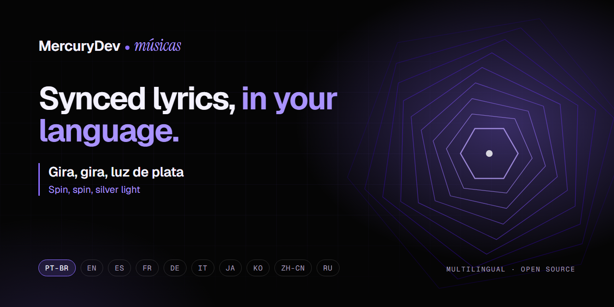
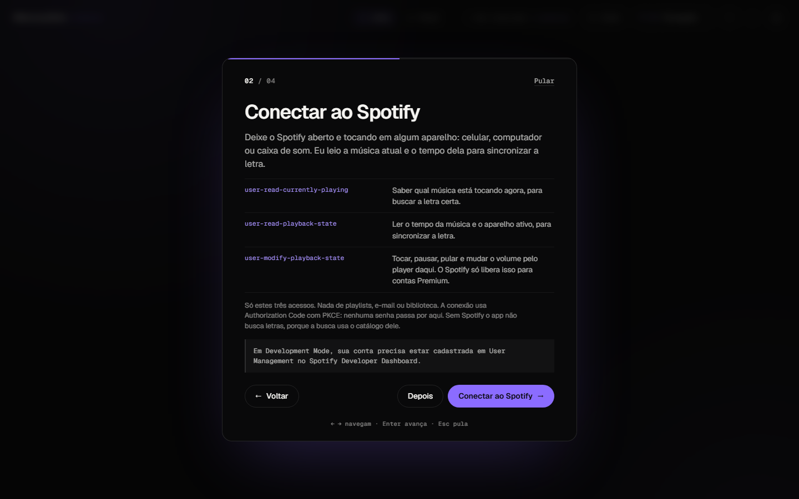
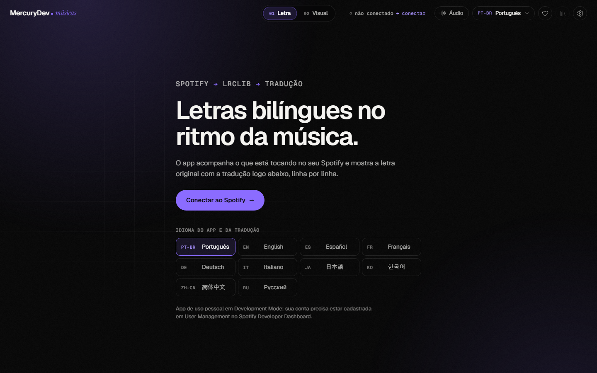
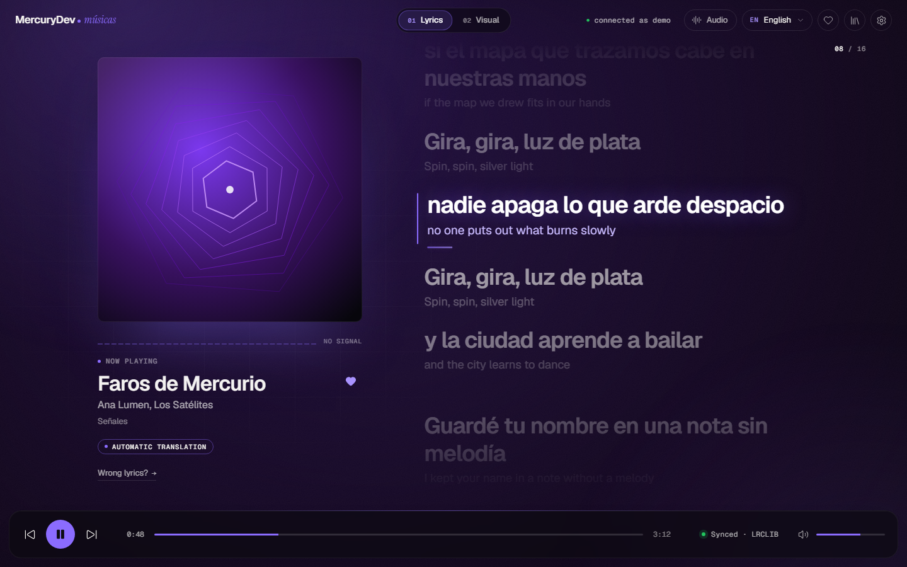
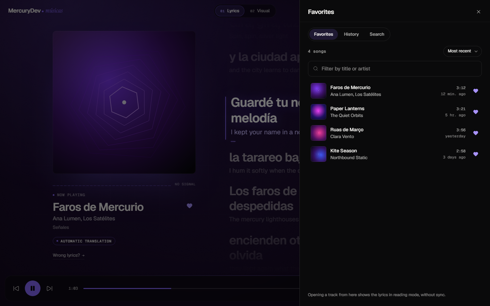
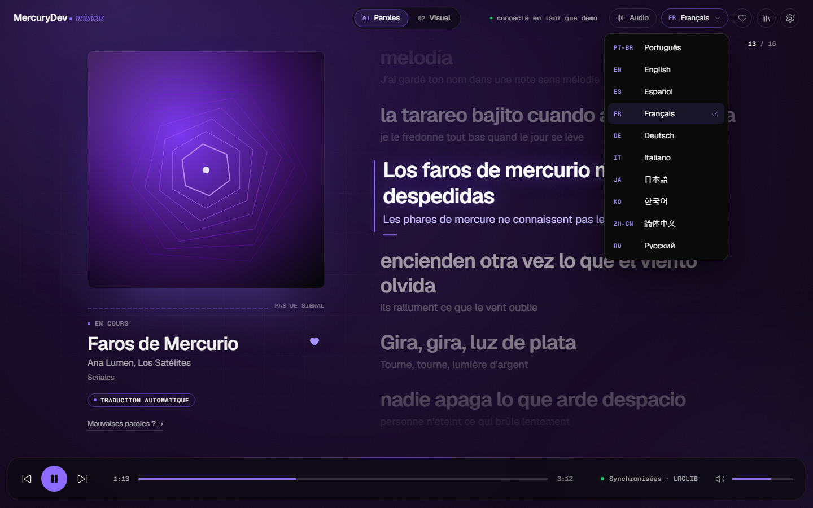
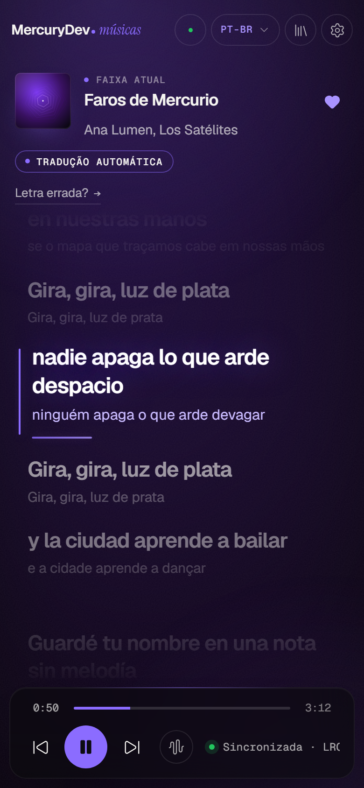

<p align="center">
  
</p>

<h1 align="center">MercuryDev Músicas</h1>

<p align="center">
  <strong>Letra sincronizada do que está tocando no Spotify, traduzida linha a linha para o seu idioma.</strong>
</p>

<p align="center">
  <a href="LICENSE"></a>
  
  
  
  
  
  
</p>

<p align="center">
  <a href="README.md">English</a> · Português (Brasil)
</p>

---

MercuryDev Músicas é um app web para hospedar você mesmo:
- acompanha a música que está tocando na sua conta do Spotify;
- busca a letra no [LRCLIB](https://lrclib.net);
- mostra a letra original com a tradução embaixo de cada linha, no ritmo da música.

A interface inteira e a tradução seguem o idioma que você escolher. São 10 idiomas prontos.

É uma ferramenta pessoal. Você roda na sua máquina, com o seu app do Spotify (Development Mode) e a sua chave de tradução.

## Sumário

- [Funcionalidades](#funcionalidades)
- [Multilíngue de verdade](#multilíngue-de-verdade)
- [Prints](#prints)
- [Como rodar](#como-rodar)
- [Como funciona](#como-funciona)
- [Como adicionar um idioma](#como-adicionar-um-idioma)
- [Limitações](#limitações)
- [Roadmap](#roadmap)
- [Deploy](#deploy)
- [Direitos e avisos](#direitos-e-avisos)
- [Créditos e contato](#créditos-e-contato)

## Funcionalidades

- **Letra sincronizada:** a linha ativa fica em destaque e a rolagem é automática. Um fio fino mostra o progresso da linha, e um contador `07 / 42` mostra a posição.
- **Tradução automática para vários idiomas:**
  - a tradução aparece embaixo de cada linha;
  - refrões repetidos são traduzidos uma vez só;
  - linhas que já estão no seu idioma ficam como estão;
  - provedores: DeepL (sem LLM), Anthropic ou qualquer API compatível com OpenAI.
- **Interface totalmente traduzida:**
  - todas as telas, mensagens e erros vêm de dicionários i18n;
  - pt-BR é o padrão e o fallback;
  - trocar o idioma vale na hora, sem recarregar a página, e retraduz a letra aberta.
- **Integração com o Spotify (OAuth PKCE):**
  - o fluxo Authorization Code com PKCE roda no servidor, sem client secret em lugar nenhum;
  - os tokens ficam criptografados e são renovados automaticamente;
  - respostas 401/429 têm nova tentativa com backoff;
  - tokens nunca vão para os logs.
- **Controles do player:** play, pausa, pular, avançar e volume. O Spotify só libera isso pela API para contas Premium, e a interface avisa nas contas Free.
- **Favoritas:**
  - coração em qualquer faixa;
  - tela Favoritas com contador, filtro, ordenação (mais recentes primeiro) e remoção;
  - salvas no servidor por conta do Spotify, continuam visíveis depois de desconectar.
- **Tutorial de primeiro acesso:**
  - quatro passos: boas-vindas, conectar o Spotify (com cada permissão explicada), idioma e favoritas;
  - funciona pelo teclado, com Pular e Voltar em todos os passos;
  - pode ser reaberto em Configurações.
- **Indicador de conexão** em estilo log (`● conectado como …` / `○ não conectado → conectar`), com botão para desconectar.
- **Letra sem timestamps:** rolagem estimada, ou "Sincronizar tocando": você toca em cada linha quando ela começa e os tempos ficam salvos.
- **"Letra errada?"** para escolher outro candidato do LRCLIB, e offset de sincronização por faixa.
- **Modo Visual:** seis visualizadores em Canvas 2D que reagem ao áudio do sistema ou do microfone. O áudio é usado só para análise: nada é reproduzido, gravado ou enviado.
- **Identidade visual MercuryDev:** base escura, roxo-mercúrio, Geist e Geist Mono, linhas geométricas. Funciona em desktop, tablet e celular.
- **Acessibilidade:**
  - foco visível no teclado;
  - aria-labels;
  - seletor de idioma acessível (listbox e radiogroup);
  - respeita `prefers-reduced-motion`.

## Multilíngue de verdade

Uma escolha define **o idioma da interface e o destino da tradução das letras**. O padrão é **pt-BR**.

| Código | Idioma | Dicionário da interface |
|---|---|---|
| `pt-BR` | Português (Brasil) | fonte da verdade, fallback |
| `en` | English | revisado |
| `es` | Español | revisado |
| `fr` | Français | revisado |
| `de` | Deutsch | revisado |
| `it` | Italiano | revisado |
| `ja` | 日本語 | provisório, precisa de revisão nativa |
| `ko` | 한국어 | provisório, precisa de revisão nativa |
| `zh-CN` | 简体中文 | provisório, precisa de revisão nativa |
| `ru` | Русский | provisório, precisa de revisão nativa |

Como a escolha funciona:
- **Onde fica salva:** no `localStorage` (`mercurydev-musicas:lang`).
- **Sem piscar:** a escolha é carregada antes do primeiro render, então o idioma errado nunca aparece.
- **Na página:** atualiza `<html lang>`, `dir` e o título da aba.
- **No servidor:** vai para as configurações, para a tradução usar o mesmo idioma.
- **Formatos:** datas, números e "há 5 min" usam `Intl` no idioma escolhido.
- **RTL:** cada idioma já tem `dir` (`ltr`/`rtl`), pronto para um idioma da direita para a esquerda.
- **Testes:** o `npm test` garante que todos os dicionários têm exatamente as chaves e os placeholders do pt-BR, e que toda chave usada no código existe.

Para adicionar outro idioma, veja [Como adicionar um idioma](#como-adicionar-um-idioma).

## Prints

> **Ilustrativos.** Os prints usam dados de exemplo originais:
> - música e artista fictícios ("Faros de Mercurio", de "Ana Lumen, Los Satélites"), com letra escrita para esta demonstração;
> - capas geradas;
> - sessão do Spotify simulada (usuário `demo`).
>
> Não aparece nenhuma letra real, capa de álbum ou dado pessoal.

| Tutorial: conectar o Spotify | Escolha de idioma na tela inicial |
|---|---|
|  |  |

| Letra sincronizada, interface e tradução em português | Mesma música, interface e tradução em inglês |
|---|---|
|  |  |

| Favoritas | Seletor de idioma com a interface em francês |
|---|---|
|  |  |

<p align="center">
  
</p>

## Como rodar

### Pré-requisitos

- **Node.js 22.6+** (testado no 24). O `better-sqlite3` baixa um binário pronto na instalação.
- **Conta no Spotify** para criar o app no [Spotify Developer Dashboard](https://developer.spotify.com/dashboard). Em Development Mode, o Spotify exige que o **dono do app** tenha Premium ativo.
- **Para ter a letra traduzida: chave da API do DeepL** (o plano Free basta: 500.000 caracteres por mês). Sem provedor de tradução o app funciona, mas mostra só a letra original. Uma chave da Anthropic ou qualquer endpoint compatível com OpenAI também serve no lugar do DeepL (veja o [passo 3](#3-configurar-a-tradução-deepl)).

### 1. Criar o app no Spotify

1. Abra o [Spotify Developer Dashboard](https://developer.spotify.com/dashboard) e clique em **Create app**.
2. Em **Redirect URIs**, cadastre exatamente:
   ```
   http://127.0.0.1:8787/callback
   ```
   Use `127.0.0.1`: o Spotify não aceita `localhost`. A porta é a do servidor da API (`PORT`), não a do Vite.
3. Em **Which API/SDKs are you planning to use?**, marque **Web API** e salve.
4. Em **Settings**, copie o **Client ID**. Não precisa de Client Secret: o login usa Authorization Code com PKCE.
5. Em **User Management**, adicione nome e **e-mail da conta Spotify** de cada pessoa que vai usar a sua instância (até 5 em Development Mode).

**Escopos pedidos** (definidos em `SPOTIFY_SCOPES`, em `apps/server/src/config.ts`, e explicados no passo 02 do tutorial):

| Escopo | Para quê |
|---|---|
| `user-read-currently-playing` | saber qual música está tocando, para buscar a letra |
| `user-read-playback-state` | ler o tempo da música e o aparelho ativo, para sincronizar |
| `user-modify-playback-state` | tocar, pausar, pular e mudar o volume pelo app. O Spotify só aceita isso de contas **Premium** |

### 2. Configurar o ambiente

```bash
git clone https://github.com/higorkehrle/mercurydev-musicas.git
cd mercurydev-musicas
npm install
cp .env.example .env
node -e "console.log(require('crypto').randomBytes(32).toString('hex'))"   # cole em TOKEN_ENCRYPTION_KEY
```

Abra o `.env` novo e preencha `SPOTIFY_CLIENT_ID` (do passo 1) e `TOKEN_ENCRYPTION_KEY` (o valor impresso pelo comando `node -e`). Os dois são obrigatórios: sem eles o servidor sobe, mas mostra um aviso de configuração e o login fica desativado. Para ter tradução, defina também `TRANSLATION_PROVIDER` e `TRANSLATION_API_KEY` ([passo 3](#3-configurar-a-tradução-deepl)). Todas as variáveis estão documentadas no [`.env.example`](.env.example) e na [tabela do README em inglês](README.md#2-configure-the-environment).

> Nunca faça commit do `.env`. Ele está no `.gitignore`; só o `.env.example` é versionado.

### 3. Configurar a tradução (DeepL)

A tradução é o que coloca a versão traduzida de cada linha embaixo da original. O DeepL é o provedor recomendado: é tradução automática clássica (sem LLM) e o plano Free cobre o uso pessoal.

1. Crie uma conta grátis em [deepl.com/pro-api](https://www.deepl.com/pro-api) (escolha **DeepL API Free**). Pede cartão para verificação; o plano Free não é cobrado.
2. Abra [deepl.com/your-account/keys](https://www.deepl.com/your-account/keys) e copie a **Authentication Key**. Chaves Free terminam em `:fx`.
3. No `.env`, defina:
   ```bash
   TRANSLATION_PROVIDER=deepl
   TRANSLATION_API_KEY=sua-chave-aqui:fx
   ```
   Chaves Free (`:fx`) usam `api-free.deepl.com` automaticamente; qualquer outra chave usa `api.deepl.com`. Você não configura o endpoint nem o `TRANSLATION_MODEL`.
4. Inicie (ou reinicie) o servidor. O `.env` só é lido na inicialização.

A chave fica no servidor; o navegador nunca a vê. Para usar outro provedor, defina `TRANSLATION_PROVIDER=anthropic` (`TRANSLATION_MODEL` opcional) ou `TRANSLATION_PROVIDER=openai` (exige `TRANSLATION_MODEL`; `TRANSLATION_BASE_URL` opcional). Com `TRANSLATION_PROVIDER=none`, ou sem chave, só a letra original aparece.

**O que acontece quando uma música toca** (detalhes em [Como funciona](#como-funciona)):
1. O servidor busca a letra e detecta o idioma. Linhas que já estão no idioma escolhido são ignoradas.
2. Linhas repetidas, como refrões, são traduzidas uma vez só.
3. As linhas únicas vão ao DeepL em lotes de até 50, com título e artista como contexto.
4. A resposta é validada linha a linha; se não bater, o servidor tenta de novo e depois cai para blocos do tamanho de uma estrofe.
5. O resultado é salvo no SQLite local, então cada música é traduzida uma única vez por idioma.

### 4. Rodar

```bash
npm run dev        # API em 127.0.0.1:8787 + Vite em 127.0.0.1:5173
```

Abra **http://127.0.0.1:5173** (não `localhost`: o cookie de sessão é por host). Siga o tutorial ou clique em **Conectar ao Spotify** e dê play em qualquer aparelho. A letra aparece em poucos segundos, com a tradução embaixo de cada linha.

O terminal mostra `INFO: Server listening at http://127.0.0.1:8787`. Se também mostrar `WARN: incomplete configuration`, a linha seguinte diz qual valor do `.env` está faltando.

**Solução de problemas**

| Sintoma | Causa e solução |
|---|---|
| `WARN: incomplete configuration` com `SPOTIFY_CLIENT_ID is not set` | Falta o `.env`, ou ele ainda tem o placeholder `your_spotify_client_id_here`. Cole o Client ID real e reinicie |
| `TOKEN_ENCRYPTION_KEY is missing or invalid` | Precisa ter 32 bytes, como 64 caracteres hexadecimais (ou base64). Gere de novo com o comando `node -e` do passo 2 |
| O Spotify mostra `INVALID_CLIENT: Invalid redirect URI` | O Redirect URI no Dashboard precisa ser exatamente `http://127.0.0.1:8787/callback` |
| O login funciona para você, mas não para um amigo | Adicione o e-mail da conta Spotify dele em **User Management** no Dashboard (passo 1.5) |
| A letra aparece, mas sem tradução: "Machine translation is not configured" | `TRANSLATION_PROVIDER` ou `TRANSLATION_API_KEY` está vazio. Siga o passo 3 e reinicie |
| "DeepL rejected the key" | Chave errada ou revogada. Copie de novo da sua conta DeepL, incluindo o sufixo `:fx` |
| "The monthly DeepL quota is used up" | O limite do plano Free acabou. Espere o próximo mês ou mude de plano; músicas já em cache continuam funcionando |
| Play, pause e volume desativados | O Spotify só libera o controle de reprodução para contas Premium. Letra e tradução continuam funcionando |

Build de produção servido pela própria API:

```bash
npm run build
# no .env: WEB_ORIGIN=http://127.0.0.1:8787  (e COOKIE_SECURE=false se o navegador recusar o cookie em http)
npm start          # API + frontend em http://127.0.0.1:8787
```

| Comando | O que faz |
|---|---|
| `npm run dev` | servidor da API (tsx watch) + frontend (Vite) |
| `npm test` | testes unitários (Vitest) |
| `npm run typecheck` | checagem de tipos dos três pacotes |
| `npm run build` | build do frontend em `apps/web/dist` |
| `npm start` | servidor em produção, servindo o build |

## Como funciona

```
apps/server        Fastify + SQLite (better-sqlite3)
  spotify/           login PKCE, refresh automático, cliente da Web API (429/Retry-After, cooldown por usuário)
  lyrics/            LyricsProvider: LRCLIB (principal), Musixmatch (opcional, só com chave licenciada); parser LRC; escolha de candidato
  translation/       TranslationProvider: DeepL / Anthropic / compatível com OpenAI; detecção de idioma (franc); validação estrita
  storage/           sessões, cache de letras/traduções, histórico, favoritas, offsets, tempos manuais, configurações
apps/web           React 19 + Vite: interface, i18n (src/i18n, src/locales), visualizador (src/lib/visualizer)
packages/shared    tipos, interfaces dos provedores, PlaybackTracker e SyncEngine (sem DOM, com testes)
```

- **Música atual:** o `PlaybackTracker` consulta o Spotify em ritmo adaptativo.
  - A cada ~3 s com o app em foco e a cada ~10 s em segundo plano.
  - Para depois de 2 min com a aba oculta e retoma quando você volta.
  - Entre consultas, estima o progresso localmente.
- **Fonte das letras: [LRCLIB](https://lrclib.net)**, banco comunitário público e documentado.
  - Primeiro tenta a assinatura exata.
  - Se não achar, faz uma busca e escolhe por título normalizado, artista e duração (±2 s), preferindo letra sincronizada.
- **Tradução:**
  - Uma chamada por música, pedindo JSON estrito com os mesmos índices.
  - A resposta é validada. Se falhar, repete 1× e depois traduz por estrofe. Uma linha nunca é deslocada.
  - Provedores: **DeepL** (tradução automática clássica, sem LLM), **Anthropic** (Claude) ou API **compatível com OpenAI**.
- **Sincronização:**
  - O `SyncEngine` escolhe a linha de maior `startMs ≤ tempo + offset` a cada quadro.
  - No pause, congela.
  - Em seek ou troca de faixa, reposiciona na hora.
  - Drift pequeno (< 400 ms) é corrigido suavemente.
- **Segurança:**
  - O Client ID e os tokens ficam só no servidor, com o refresh token criptografado (AES-256-GCM).
  - O navegador recebe só um cookie de sessão `httpOnly`.
  - Mutações exigem `Origin` igual a `WEB_ORIGIN`.
  - Os logs redigem cookies, `authorization`, `code`/`state` e tokens.
- **Favoritas:**
  - O SQLite do servidor (tabela `favorites`, por usuário do Spotify) é a fonte da verdade.
  - Uma cópia mínima e versionada no `localStorage` (`mercurydev-musicas:favorites:v1`) mantém a lista visível quando você está desconectado.

## Como adicionar um idioma

1. Inclua uma entrada em `TARGET_LANGUAGES`, em [`packages/shared/src/languages.ts`](packages/shared/src/languages.ts). Campos:
   - `code` (BCP-47);
   - `label` (nome na própria língua);
   - `short` (rótulo do seletor);
   - `promptName` (nome em inglês, enviado aos LLMs);
   - `franc` (ISO 639-3);
   - `dir` (`ltr`/`rtl`).
2. Copie [`apps/web/src/locales/pt-BR.json`](apps/web/src/locales/pt-BR.json) para `apps/web/src/locales/<código>.json` e traduza os valores.
   - Mantenha as chaves e os `{placeholders}`.
   - Plurais usam os sufixos `.zero/.one/.few/.many/.other` (via `Intl.PluralRules`). Só as formas que a língua usa são necessárias, mais `.other`.
3. Se usar DeepL, mapeie o `promptName` para o código do DeepL em `DEEPL_TARGET` ([`apps/server/src/translation/providers.ts`](apps/server/src/translation/providers.ts)).
4. Rode `npm test`. O teste dos dicionários falha se faltar chave ou placeholder.

O idioma novo aparece sozinho na grade da tela inicial, no tutorial e no seletor do topo. Chaves ausentes caem para o pt-BR.

## Limitações

- **Development Mode do Spotify:** até 5 usuários por instância, cada um cadastrado em *User Management*, e o dono do app precisa de Premium.
- **Controles exigem Premium.** O Spotify só aceita play, pausa, pular, avançar e volume pela Web API de contas Premium. Em contas Free, letra e tradução funcionam e os controles explicam por que estão desabilitados.
- **Sem acesso ao áudio.** O Spotify não expõe o áudio (DRM), então não existe sincronização pelo som.
  - Letra sem timestamps fica com rolagem estimada ou sincronização manual.
  - O visualizador precisa do áudio do sistema ou do microfone.
- **"Spotify fechado" e "nada tocando" são o mesmo estado** na Web API (204 sem conteúdo). O app mostra uma única mensagem para os dois.
- **Sessão privada** esconde a faixa atual da API. **Podcasts e anúncios** não têm letra.
- **Cobertura do LRCLIB** depende da comunidade. Use **Letra errada?** para escolher outro candidato.
- **Atraso de detecção:** mudanças feitas no app do Spotify aparecem na próxima consulta (~3 s com o app em foco).
- **Tradução automática** é sempre identificada como tal. A detecção de idioma por linha é heurística.
- **Dicionários provisórios:** ja, ko, zh-CN e ru (veja a tabela acima).

## Roadmap

São ideias, não promessas:

- Revisão nativa dos dicionários ja, ko, zh-CN e ru.
- Um primeiro idioma da direita para a esquerda (a estrutura já tem `dir`).
- Imagem de container para hospedar com um comando.
- Outros provedores de letra pela interface `LyricsProvider`, só com APIs devidamente licenciadas.

## Deploy

O app é um servidor Node.js de longa duração, com um arquivo SQLite local e um módulo nativo (`better-sqlite3`). Por isso, roda melhor numa máquina ou VPS com disco persistente.

Plataformas serverless como Vercel Functions ou Cloudflare Workers **não o rodam sem adaptação**, porque não têm SQLite local persistente.

Para publicar:
1. Rode `npm run build && npm start` atrás de HTTPS.
2. Defina `WEB_ORIGIN` e `SPOTIFY_REDIRECT_URI` com o seu domínio.
3. Cadastre esse `https://…/callback` no Spotify Dashboard.
4. Mantenha `COOKIE_SECURE=true`.

## Direitos e avisos

- **Letras pertencem aos seus autores e titulares de direitos.**
  - O app só exibe, em tempo de execução, letras de serviços de terceiros (LRCLIB, ou Musixmatch com chave licenciada) para a música que você está ouvindo.
  - Não inclui, publica nem redistribui letras, e não expõe endpoint público de letras.
  - O cache fica só no seu arquivo SQLite local, fora do git.
- **As traduções são automáticas** e identificadas como tal na interface.
- **Spotify** é marca registrada da Spotify AB. Este projeto **não é afiliado, endossado nem patrocinado pelo Spotify** e usa a Web API pública do Spotify conforme os termos dela.
- **Conteúdo de demonstração:** letra, artistas e capas de `docs/screenshots` são originais e fictícios.
- **Fontes:** Geist, Geist Mono e Instrument Serif usam a SIL Open Font License e são instaladas pelo npm (`@fontsource`). Não ficam guardadas neste repositório.

## Créditos e contato

- Feito pela **[MercuryDev](https://www.mercurydev.com.br/)**.
- Letras: [LRCLIB](https://lrclib.net).
- Detecção de idioma: [franc](https://github.com/wooorm/franc).
- Tradução: [DeepL](https://www.deepl.com/pro-api), [Anthropic](https://www.anthropic.com/) ou qualquer API compatível com OpenAI (a escolha e a chave são suas).
- Contribuir: [CONTRIBUTING.md](CONTRIBUTING.md). Segurança: [SECURITY.md](SECURITY.md).
- Licença: [MIT](LICENSE).
